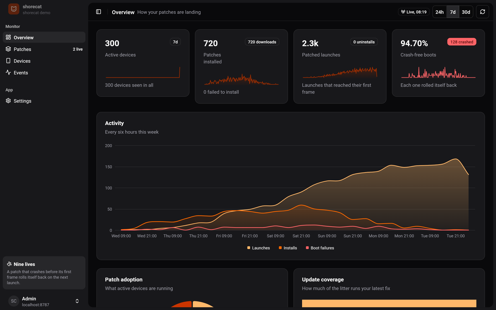
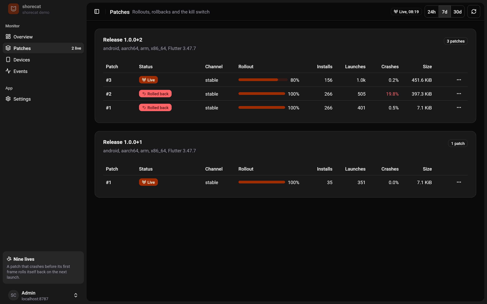
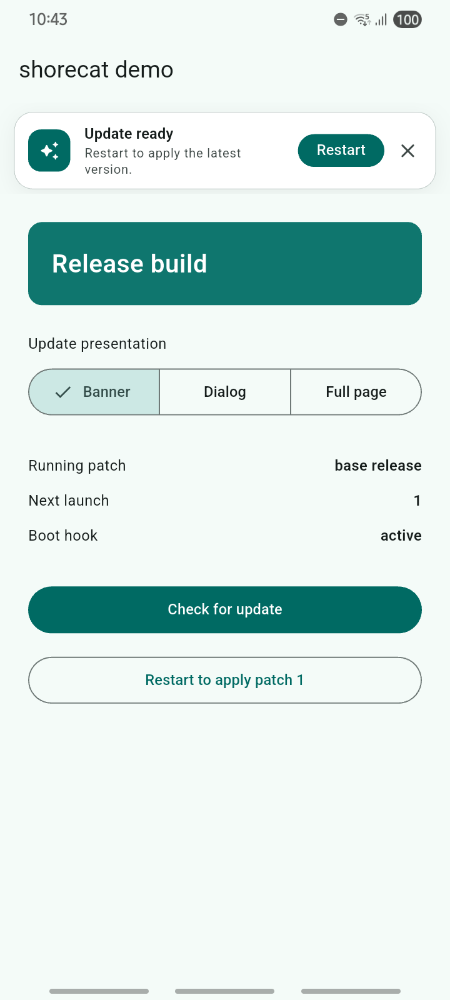
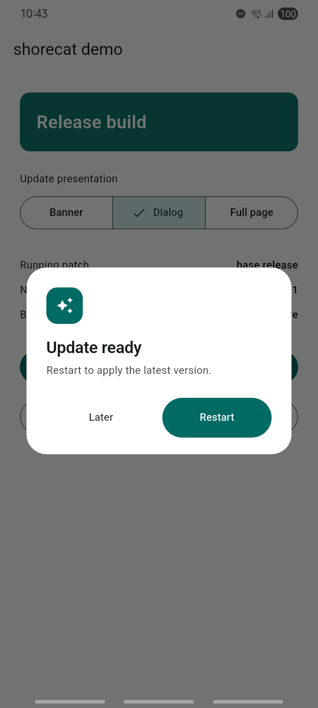
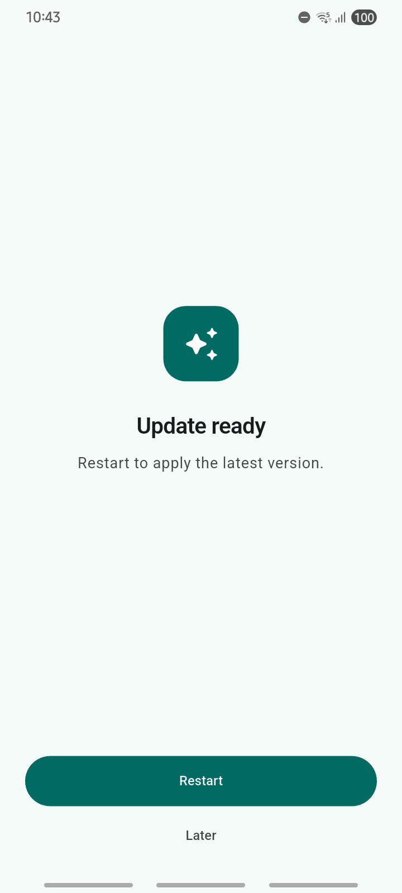

# 🐱 shorecat

**Over-the-air Dart updates for Flutter Android apps. Always lands on its feet.**

*Ship a fix before your users finish their cat nap.*

[](https://github.com/cyenite/shorecat/actions/workflows/check.yml)
[](https://github.com/cyenite/shorecat/actions/workflows/release.yml)
[](https://pub.dev/packages/shorecat_code_push)
[](LICENSE)

You shipped a bug. It happens. Shorecat lets you send a Dart fix to your users
without waiting for another store release. Updates download in the background
and take effect on the next launch. If a patch crashes before its first frame,
the app rolls back on the following launch. One less hairball to deal with.

Host it on your own server, sign patches with your own keys, and roll them out
gradually. The included dashboard, built with [Ashlar UI](https://ui.ashlar.ke),
tracks adoption, devices and boot failures.



## 1. Install the server

You need a Linux server with Docker Compose and a domain pointing to it.
Download and extract the
[latest deployment bundle](https://github.com/cyenite/shorecat/releases/latest/download/shorecat-deploy.tar.gz),
then run:

```bash
cp .env.example .env
chmod 600 .env
# Set SHORECAT_PUBLIC_URL in .env to your HTTPS origin.
docker compose up -d
docker compose exec shorecat cat /data/admin-token
```

Open your public URL and sign in with that token. The container includes the
dashboard and persistent storage; Caddy handles HTTPS. Supports amd64 and arm64.
See the [hosting guide](docs/hosting.md) for DNS, ports and proxy setup.

## 2. Connect your Flutter app

Run these commands inside your Flutter project:

```bash
dart pub global activate shorecat_cli
flutter pub add shorecat_code_push
shorecat init --server https://updates.example.com --token <admin-token>
```

Initialize Shorecat before `runApp()`:

```dart
import 'package:flutter/widgets.dart';
import 'package:shorecat_code_push/shorecat_code_push.dart';

Future<void> main() async {
  WidgetsFlutterBinding.ensureInitialized();
  await Shorecat.initialize();
  runApp(const MyApp());
}
```

Back up the signing keys in `~/.config/shorecat/keys/`.

## 3. Ship updates

```bash
shorecat doctor
shorecat release android
# Distribute the release, then make your Dart changes.
shorecat patch android --rollout 10 --notes "Fix checkout"
```

Monitor adoption, increase rollout or roll back from the dashboard.

<details>
<summary>Peek at the patch cat-alogue</summary>

Manage rollouts and rollbacks for each release. Screenshots use demo data.



</details>

## 4. Offer a restart, on their terms

Add an optional update prompt inside your Material app's screen:

```dart
Scaffold(
  body: ShorecatUpdatePrompt(
    presentation: ShorecatUpdatePresentation.banner,
    child: const YourScreen(),
  ),
)
```

Choose `.banner`, `.dialog` or `.page`. Once a patch is downloaded and verified,
users can **Restart** to apply it or choose **Later**. No surprise cat naps.
Use `onBeforeRestart` to save work or confirm before restarting. Want your own
design? Pass a `builder`, or place `ShorecatUpdateBuilder` anywhere, and call
`restart()` and `defer()` from your buttons. See the
[prompt guide](packages/shorecat_code_push/README.md#choose-an-update-prompt)
and [custom screens](packages/shorecat_code_push/README.md#build-your-own-update-screen).

<details>
<summary>See the three update presentations on Android</summary>

Banner, dialog and full page, captured on a Galaxy A05:

<p>
  
  
  
</p>

</details>

## Supported use

Android release builds, Dart code only. Patches must use the release's Flutter
engine version. Native code and asset changes require a new app release. Run one
server instance per data volume and check your distribution channel's code-update
policy.

## Documentation

- [Hosting, backups and upgrades](docs/hosting.md)
- [CLI commands](packages/shorecat_cli/README.md)
- [Architecture](docs/architecture.md)
- [Maintainer release guide](docs/releasing.md)

## 😼 Why shorecat instead of a hosted, paid code-push service

Hosted code-push services are convenient. They also have you paying rent on
your own app's updates, running a modified engine, and trusting someone else
with your release pipeline. shorecat is the alley cat that answers to nobody:

| | Typical hosted / paid code push | 🐱 shorecat |
|---|---|---|
| **Price** | Per-install or per-user pricing that grows with your success | Free. Self-hosted. Your 10 millionth install costs what your first did |
| **Your data** | Release artifacts, device IDs and crash signals live on their servers | Everything lives on a server you run. One binary, one data folder |
| **Flutter engine** | Often a forked engine you must wait on after every Flutter release | The **stock** Flutter engine. Upgrade Flutter the day it ships |
| **Lock-in** | Their CLI, their console, their roadmap, their shutdown risk | Open source, plain JSON storage, a documented HTTP API. Fork it, own it |
| **Patch signing** | Optional, or a paid tier | **Mandatory** Ed25519. Each signature is bound to the app, release, CPU and patch number, so a signed patch cannot be replayed elsewhere |
| **"Did it boot?"** | Usually "the VM started" | "It drew its first frame". A patch that throws in `main()` is caught too |
| **Bad patch on one phone** | Rolls back | Rolls back, with a configurable number of retries |
| **Bad patch on many phones** | You notice, then you act | The **health gate** rolls it back for everyone once its crash rate crosses your threshold |
| **Rollouts** | Often all or nothing | Staged percentages with stable per-device buckets, channels, pause, resume, kill switch |
| **The updater itself** | Baked into native code | Plain Dart, so a bug in the updater can be fixed... by a patch. Yes, we did that on a real phone |
| **Patch format** | Opaque | `SCDELTA1`: bsdiff-style delta with both endpoints pinned by SHA-256, compressed with whichever of zstd, bzip2 or zlib wins |
