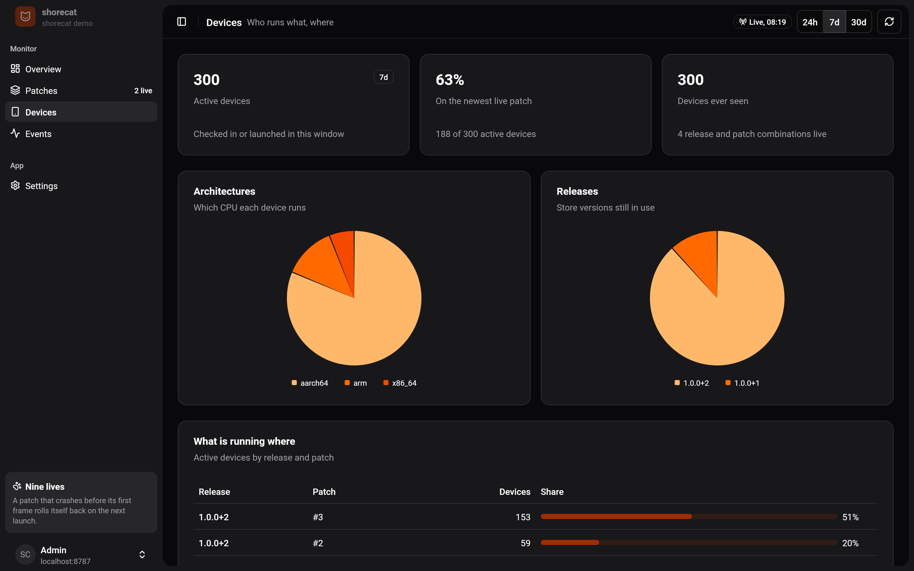

<div align="center">

# 🐱 shorecat

**Over-the-air Dart updates for Flutter apps. Always lands on its feet.**

*Ship a fix before your users finish their cat nap.*

</div>

---

You shipped a bug. It happens to the best of us. Usually the store review queue
then makes everyone wait a few days while the bug sits there knocking things
off the table.

shorecat lets you push a fixed Dart build straight to your users' phones. It
downloads quietly in the background and the fix is live on the next launch. If
the fix itself turns out to be a hairball, the phone coughs it up and goes back
to the last version that worked. No crash loop, no 1-star review, no
cat-astrophe.


## 😼 Why shorecat instead of a hosted, paid code-push service

Hosted code-push services are convenient. They also have you paying rent on
your own app's updates, running a modified engine, and trusting someone else
with your release pipeline. shorecat is the alley cat that answers to nobody:

| | Typical hosted / paid code push | 🐱 shorecat |
|---|---|---|
| **Price** | Per-install or per-user pricing that grows with your success | Free. Self-hosted. Your 10 millionth install costs what your first did |
| **Your data** | Release artifacts, device IDs and crash signals live on their servers | Everything lives on a server you run. One binary, one data folder |
| **Flutter engine** | Often a forked engine you must wait on after every Flutter release | The **stock** Flutter engine. Upgrade Flutter the day it ships |
| **Lock-in** | Their CLI, their console, their roadmap, their shutdown risk | Open source, plain JSON storage, a documented HTTP API. Fork it, own it |
| **Patch signing** | Optional, or a paid tier | **Mandatory** Ed25519. Each signature is bound to the app, release, CPU and patch number, so a signed patch cannot be replayed elsewhere |
| **"Did it boot?"** | Usually "the VM started" | "It drew its first frame". A patch that throws in `main()` is caught too |
| **Bad patch on one phone** | Rolls back | Rolls back, with a configurable number of retries |
| **Bad patch on many phones** | You notice, then you act | The **health gate** rolls it back for everyone once its crash rate crosses your threshold |
| **Rollouts** | Often all or nothing | Staged percentages with stable per-device buckets, channels, pause, resume, kill switch |
| **The updater itself** | Baked into native code | Plain Dart, so a bug in the updater can be fixed... by a patch. Yes, we did that on a real phone |
| **Patch format** | Opaque | `SCDELTA1`: bsdiff-style delta with both endpoints pinned by SHA-256, compressed with whichever of zstd, bzip2 or zlib wins |

## 🐾 Proof, not purr-omises

Everything below happened on a real Samsung Galaxy A05 (Android 15, arm64)
running a release build on stock Flutter 3.47.7:

1. Installed release `1.0.0+2`.
2. Pushed a new label and colour: a **7.1 KiB** patch against a 4.19 MiB
   `libapp.so`. Downloaded on one launch, running on the next.
3. Pushed a patch that throws before `runApp`. It booted, never drew a frame,
   and the next launch rolled back to the previous patch on its own and told
   the server.
4. Pushed a fix *to the updater itself* (about 450 KiB), installed by the
   older updater.
5. Rolled everything back from the CLI. The phone went back to the store
   build.

Two bugs only showed up on the device. Both are fixed, and both are
written up in the [architecture notes](docs/architecture.md).

## 🧶 How it works, in one hairball

```
 your laptop                          your shorecat server              your users' phones
 -----------                          --------------------              ------------------
 shorecat release android  --------->  release libapp.so (per CPU)
 fix some Dart
 shorecat patch android    --------->  signed delta + rollout %  <----   "anything new?"
                                       health gate               ---->   delta, signature
                                       dashboard                 <----   installs, launches, crashes
                                                                         Kotlin boot hook picks
                                                                         the patch before Flutter starts
```

Flutter's own loader can boot a replacement `libapp.so` from the app's private
storage. shorecat rebuilds that file on the device from a tiny delta, checks its
hash and signature, and asks Flutter to load it on the next launch. If the
launch never reaches its first frame, the breadcrumb is still there next time,
and the patch is marked bad. Nine lives, used responsibly.

Details: [docs/architecture.md](docs/architecture.md).

## 🐈 Quick start

The easiest server installation is Docker: the image includes the server and
built dashboard. Users need Docker and Compose on their server, plus a domain for
HTTPS. See [Hosting Shorecat](docs/hosting.md) for the complete installation,
existing reverse proxies, backups, restore and upgrades.

```bash
# From an extracted deployment bundle; edit .env with your public HTTPS URL.
cp .env.example .env
chmod 600 .env
docker compose up -d
docker compose exec shorecat cat /data/admin-token
```

The default Compose configuration includes Caddy for automatic HTTPS. Data lives
in a persistent volume, and the service restarts after a host reboot. Release
bundles and prebuilt images become available after the first release workflow
runs; [build from source](docs/hosting.md#build-from-source-or-try-locally) before
then.

On your development machine, once the packages are published:

```bash
dart pub global activate shorecat_cli
cd /path/to/your/flutter-app
flutter pub add shorecat_code_push
shorecat init --server https://updates.example.com --token <admin-token>
```

`init` makes a signing key (it stays in `~/.config/shorecat`, never in your
repo), writes `shorecat.yaml`, bundles it as an asset, points a stock Kotlin
`MainActivity` at `ShorecatFlutterActivity` and registers the app. Import
`package:shorecat_code_push/shorecat_code_push.dart` and initialize it:

```dart
Future<void> main() async {
  WidgetsFlutterBinding.ensureInitialized();
  await Shorecat.initialize();
  runApp(const MyApp());
}
```

And then the whole litter of commands:

```bash
shorecat doctor                       # is everything purring?
shorecat release android              # build the store release, register its code
# ...fix the bug...
shorecat patch android --rollout 10 --notes "Fix the checkout crash"
shorecat patches rollout 1 100        # everyone gets it
shorecat patches rollback 1           # claw it back
shorecat keys rotate                  # fresh signing key, old releases keep working
shorecat simulate --devices 300       # fill a demo dashboard with plausible traffic
```

Tip: `dart compile exe packages/shorecat_cli/bin/shorecat.dart -o build/shorecat`
makes the CLI start instantly.

## 📊 The cat-alogue: the dashboard

Built with [Ashlar UI](https://ui.ashlar.ke) blocks and served by the server
itself. Live every 10 seconds:

- **Overview**: active devices, installs, launches and crash-free boots with
  sparklines; activity over 24 hours, 7 days or 30 days; patch adoption;
  update coverage; a weekday-by-hour launch heatmap; and the "hairballs" list
  of patches that crashed or were rolled back.
- **Patches**: every release and patch, with rollout bars and crash rates. Change
  the rollout, move channels, mark critical, pause, resume or roll back from a
  menu. Open a patch for its report counts and per-CPU artifacts.
- **Devices**: CPU and release mix, and what is running where.
- **Events**: every download, install, launch and crash, filterable.
- **Settings**: the health gate thresholds and the trusted signing keys.

| Patches | Devices |
|---|---|
|  |  |

## 🗂️ What's in the basket

| Package | What it is |
|---|---|
| `shorecat_core` | Delta format, Ed25519 signing, rollout buckets, wire protocol |
| `shorecat_server` | The server: apps, releases, patches, rollouts, health gate, telemetry, dashboard hosting |
| `shorecat_cli` | The `shorecat` command |
| `shorecat_updater` | The on-device updater, pure Dart |
| `shorecat_code_push` | The Flutter plugin plus the Kotlin boot hook, with a demo app in `example/` |
| `shorecat_dashboard` | The Flutter web dashboard (Ashlar UI) |

## 🧪 Tests

For contributor setup, install Dart/Flutter and run `bash tool/bootstrap.sh`.
This creates ignored local overrides so the Flutter plugin and example can use
unpublished sibling packages. The pure Dart workspace resolves siblings directly.
See [Releasing Shorecat](docs/releasing.md) for pub.dev and container releases.

```bash
for p in core server updater cli; do (cd packages/shorecat_$p && dart test); done
(cd packages/shorecat_code_push && flutter test)
(cd packages/shorecat_dashboard && flutter test)
(cd packages/shorecat_code_push/example/android && ./gradlew :shorecat_code_push:testDebugUnitTest)
```

## 🙀 Honest whiskers (limits)

- **Android only.** iOS does not allow loading new executable code, and
  shorecat does not ship an interpreter.
- **Dart only.** Assets, Kotlin/Java, native libraries and the manifest need a
  store release. `shorecat patch` spots those changes and refuses unless you
  say otherwise.
- **Same Flutter version.** A patch must be built with the exact engine of its
  release. The CLI checks.
- **Store policy.** Google Play restricts downloading executable native code
  from outside Play, and a `libapp.so` is exactly that. Read the current policy
  before using shorecat for Play builds. It is a natural fit for enterprise,
  sideloaded, internal and kiosk apps.
- **One server process.** The JSON store is simple on purpose. It is not a
  cluster.

---

<div align="center">

Made with 🐟 and a healthy fear of release-day bugs.

</div>
